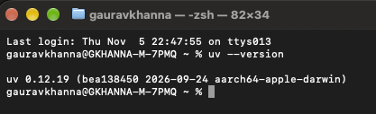
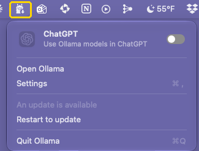
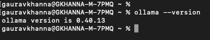
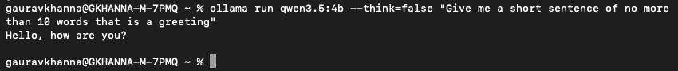
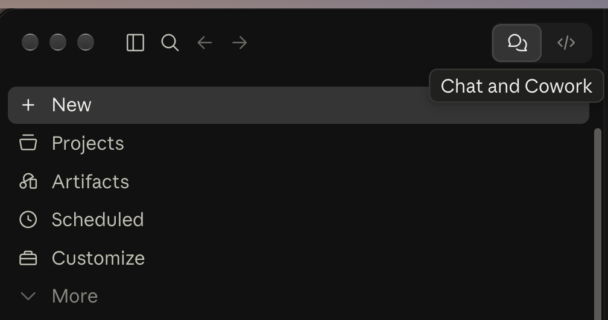
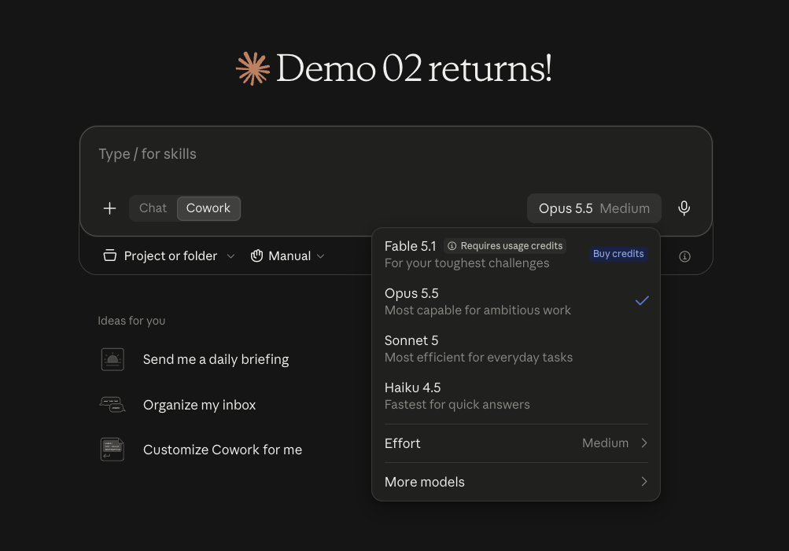

<!--
STYLE GUIDE FOR THE LAB GUIDES (this comment doesn't appear in the preview)
- Headings: one # title per document; ## for main sections; ### for sub-steps.
- Heading capitalization: Title Case. Capitalize every word except short words (a, an, the, and, or, to, of, in, on, for, as, with) unless they come first.
- Bullets: * for top-level bullets, - for sub-bullets.
- Label bullets: start with a bold label and a colon.
- Things to click or press: bold, with the exact wording on screen.
- Commands: in a code block on their own line, never bold.
- Files, folders and email addresses: `code` style.
- Names: Claude desktop app, Cowork, MCP, Streamlit, uv, Ollama, Lab 00 / Lab 01 / Lab 02.
- Images: centered <p align="center"> block with a width, one <br> before and after.
- Placeholders: <p align="center" style="color:#800000"><b>[PLACEHOLDER - description]</b></p> on its own line, with an empty line before and after. Delete it when the content is added.
- Punctuation: full sentences end with a period; no double spaces; use an em dash (—), not --.
- Spacing: one <br> (with empty lines around it) before each section heading, except the first.
- ENAS NOTE: written for the table leader, one per table, on a Mac. Nobody else installs anything.
- ENAS NOTE: uv, Ollama and the model are installed here, not during class, so nothing downloads while the clock is running.
-->

# Lab 00 — Before Class

*For table leaders. About 15 to 20 minutes at home, mostly waiting for downloads, so your table walks in ready to build.*

## Introduction

Our class together is two hours, and nearly all of it is for thinking and building. None of it should be spent installing software or waiting for downloads.

Each table builds on one laptop: the table leader's. So if your table has chosen you as its leader, everything in this guide is for you to do **before** you arrive. Six steps, about 15 to 20 minutes, and most of that is waiting for things to download.

* **All guides and materials:** [gcodekhanna1.github.io/2026-11-enas-agentic-lab](https://gcodekhanna1.github.io/2026-11-enas-agentic-lab/)

* **Not the table leader?** You have nothing to install. Read the guide for the project your table chose, and come ready to talk it through.

<br>

## What You'll Need

* **A Mac**, with permission to install software on it. An iPad won't work.

* **A local folder to build in**, such as your home folder or Documents. Never Dropbox or another folder that syncs. Step 01 shows you how.

* **Your table's lab account.** Each table has one, from `demo-01` to `demo-10`. You'll get an email telling you which is yours. Claude's sign-in link gets forwarded to your own inbox, so there's no new mailbox to check.

* **Your own email**, open, to click that link.

* **About 15 to 20 minutes**, mostly waiting for downloads.

<br>

## What You're Installing, and Why

Three things, all free.

* **The Claude desktop app** — what you'll build with. Not the website: the app, because it can work with files and folders on your own machine.

* **uv** — a tool that installs Python and whatever libraries an app needs, keeping each project's setup separate and tidy. You won't type `uv` commands during the workshop. The app you build uses it behind the scenes, and installing it now means nothing has to download while you're building the portal.

* **Ollama** — a tool that runs a small AI model on your own laptop. It lets your portal handle simple tasks without sending your information to the cloud. You'll also download the model here, so it's ready when your table needs it.

<br>

## Step 01: Create a Folder for Your Project

<p class="warning">⚠️ Create this folder in your <b>home folder</b> — the one with your user name. Do NOT put it in iCloud Drive, Dropbox, OneDrive, Box or Google Drive, and not on your Desktop or in Documents unless you're certain those aren't syncing. While Claude builds, it writes thousands of small files, and a sync app trying to upload them at the same time will break the build. This is the single most common thing that goes wrong.</p>

* In Finder, press **⌘ + Shift + H**. Your home folder opens — it's the one named after you, something like `/Users/yourname`.

* Choose **File → New Folder**.

* Name it something you'll recognize, such as `ENAS 2170 Project`.

* **Quick check:** click the folder once and press **⌘ + I**. If the "Where" line mentions iCloud, Dropbox, OneDrive, Box or Google Drive, move it to your home folder.

<br>

## Step 02: Install the Claude Desktop App

* Download it from [claude.com/download](https://claude.com/download) and choose the **macOS** version.

* Open the downloaded file and drag Claude into your **Applications** folder.

* **Already have it?** Open it and let it update to the latest version.

<br>

## Step 03: Install uv

<p class="warning">⚠️ <b>Check you're at the command line.</b> When Terminal opens, the window should end with your name and a <code>%</code> sign, like <code>yourname@MacBook ~ %</code>. If the top of the window says <b>UW PICO</b> or <b>GNU nano</b> instead, you're in a text editor, not the command line. Press <b>Control + X</b>, and if it asks to save, press <b>N</b>.</p>

This one happens in Terminal, which is a window where you type commands instead of clicking. You'll use it here and in Step 04, and probably never again during the workshop.

* Open Terminal: press **⌘ + Space**, type `Terminal`, and press **Return**.

* Copy this line, paste it into the Terminal window, and press **Return**:

```
curl -LsSf https://astral.sh/uv/install.sh | sh
```

* Wait for it to finish. You'll see a few lines of progress and then your prompt returns.

* **Now close Terminal completely** (**⌘ + Q**) and open it again. This matters — `uv` isn't available in a window that was already open before you installed it.

* Check it worked. Type this and press **Return**:

```
uv --version
```

* You should see a version number, something like `uv 0.9.x`. If you do, uv is ready.

<br>
<p align="center">
  
</p>
<br>

<p class="info">Pasting a command you don't understand into a terminal is a reasonable thing to be cautious about. This one downloads the official installer from <a href="https://astral.sh/">astral.sh</a>, the company that makes uv, and installs it in your own user account — it doesn't need an administrator password and doesn't touch the rest of your Mac.</p>

<br>

## Step 04: Install Ollama and the Model

<p class="info"><b>You don't need an Ollama account.</b> If Ollama asks you to sign in or create an account, close that window. Everything here runs without one.</p>

* Go to [ollama.com/download](https://ollama.com/download) and use the **manual download** for macOS, not the Terminal command on that page. Open the downloaded file and drag Ollama into your **Applications** folder.

* Open the Ollama app. A small llama icon appears in the menu bar at the top right of your screen. If you see it, Ollama is running.

<br>
<p align="center">
  
</p>
<br>

* In Terminal, check that it worked. You should see a line like `ollama version is 0.x.x`:

```
ollama --version
```

<br>
<p align="center">
  
</p>
<br>

* Download the model. This could take a couple of minutes:

```
ollama pull qwen3.5:4b
```

* When that finishes, give the model one short test:

```
ollama run qwen3.5:4b --think=false "Give me a short sentence of no more than 10 words that is a greeting"
```

* You should get a short reply. The first one can take a little while, because the model has to load. If you get a reply, you're done with Terminal.

<br>
<p align="center">
  
</p>
<br>

## Step 05: Sign In to Your Lab Account

* Open the Claude desktop app.

* Sign in with your table's address from the email we sent you or the [Table Leaders roster](Lab_Participants%20-%20Table%20Leaders.html), for example `demo-01@paradigmventures.ai`.

* Claude emails you a sign-in link. **It arrives in your own inbox**, because your table's account forwards there. Because it's forwarded, it can take a couple of minutes.

* Open that link **on the same Mac** you're signing in from.

<p align="center" style="color:#800000"><b>[PLACEHOLDER - screenshot of the Claude sign-in screen]</b></p>
<br>

## Step 06: Check That It Works

* In the Claude desktop app, make sure **Chat and Cowork** (the speech-bubble icon) is selected at the top of the sidebar.

<br>
<p align="center">
  
</p>
<br>

* Click **+ New** to start a session, and select **Cowork** instead of **Chat**.

<br>
<p align="center">
  
</p>
<br>

* Click **Project or folder** and select the folder you made in Step 01.

* Type a short message — `Hello, can you see my project folder?` — and check that Claude answers and names your folder back to you.

**That's it.** If that worked, you're set until class.

<p align="center" style="color:#800000"><b>[PLACEHOLDER - screenshot of a working Cowork session with the project folder connected]</b></p>
<br>

## If Something Doesn't Work

Post your question in the class forum **before class**, and Kathy or a TA will help. Every one of these takes a minute to fix beforehand and eats your table's build time on the day.

* **The sign-in email never arrives:** wait a couple of minutes, then check your spam folder, then post in the forum. The forwarding may need fixing at our end.

* **`uv --version` says "command not found":** you probably checked in the same Terminal window you installed from. Quit Terminal with **⌘ + Q**, open it fresh, and try again.

* **`ollama` says "command not found":** open the Ollama app once, then quit Terminal with **⌘ + Q**, open it fresh, and try again.

* **The model test is slow or your Mac struggles:** close other apps and try again. If it's still a problem, post in the forum.

* **You can't install software on your Mac:** post in the forum and we'll arrange something.

* **Claude can't see your folder:** check it isn't in a synced location — see the warning in Step 01.

<br>

## What's Next

Your table builds **one** of two projects together:

* **[Lab 01 — Internship, Discovery and Planner](Lab_01_Guide_Internship_Planner.html)**
* **[Lab 02 — Portfolio and Budget Tracker](Lab_02_Guide_Portfolio_Tracker.html)**

Have a look if you're curious, but don't start building. The first part of the workshop is a conversation with your table, laptops closed, writing on the printed template and sticky notes. That conversation is what makes the build work.
