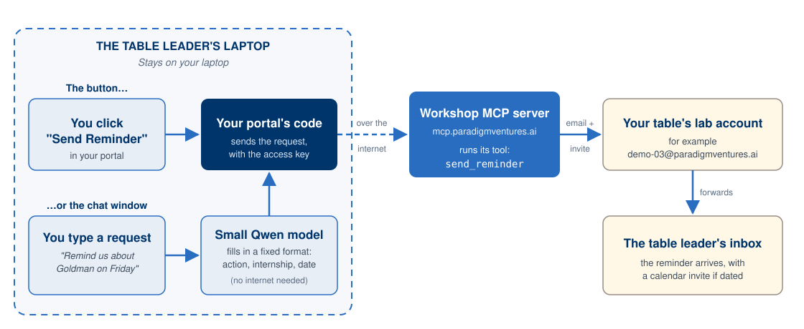

<!--
STYLE GUIDE FOR THE LAB GUIDES (this comment doesn't appear in the preview)
- Headings: one # title per document; ## for main sections; ### for sub-steps.
- Heading capitalization: Title Case. Capitalize every word except short words (a, an, the, and, or, to, of, in, on, for, as, with) unless they come first.
- Bullets: * for top-level bullets, - for sub-bullets.
- Label bullets: start with a bold label and a colon.
- Things to click or press: bold, with the exact wording on screen.
- Commands: in a code block on their own line, never bold.
- Files, folders and email addresses: `code` style.
- Names: Claude desktop app, Cowork, MCP, Streamlit, uv, Lab 00 / Lab 01 / Lab 02.
- Images: centered 
 block with a width, one   before and after.
- Placeholders: 
<b>[PLACEHOLDER - description]</b>
 on its own line, with an empty line before and after. Delete it when the content is added.
- Punctuation: full sentences end with a period; no double spaces; use an em dash (—), not --.
- Spacing: one   (with empty lines around it) before each section heading, except the first.
- ENAS NOTE: a side page for Lab 01 Step 07. Linked from Step 07, not listed on the landing page.
-->

# Lab 01 — How It Fits Together

*What happens when your portal sends a reminder.*

 

  

 

## Two Ways to Perform the Same Action

* **The button:** you click **Send Reminder**, and your portal's code sends the request straight to the workshop server.

* **The chat window:** you type a request in plain English. The small Qwen model on the laptop turns it into a fixed format, such as the action, the internship and the date, and your portal's code checks it before sending anything. The model runs on the laptop, so what you type doesn't go to the cloud.

* **Either way, the same path out:** your portal's code sends the request over the internet, with the access key, to the workshop MCP server. Its `send_reminder` tool emails your table's lab account, which forwards it to the table leader's inbox.

 

## Where's Claude?

Claude built your portal, but it isn't in this loop. Once it's built, your portal does the acting. That's the difference between a tool that helps you build something and the thing you built doing work on its own.

 

[← Back to Lab 01, Step 07](Lab_01_Guide_Internship_Planner.html)
